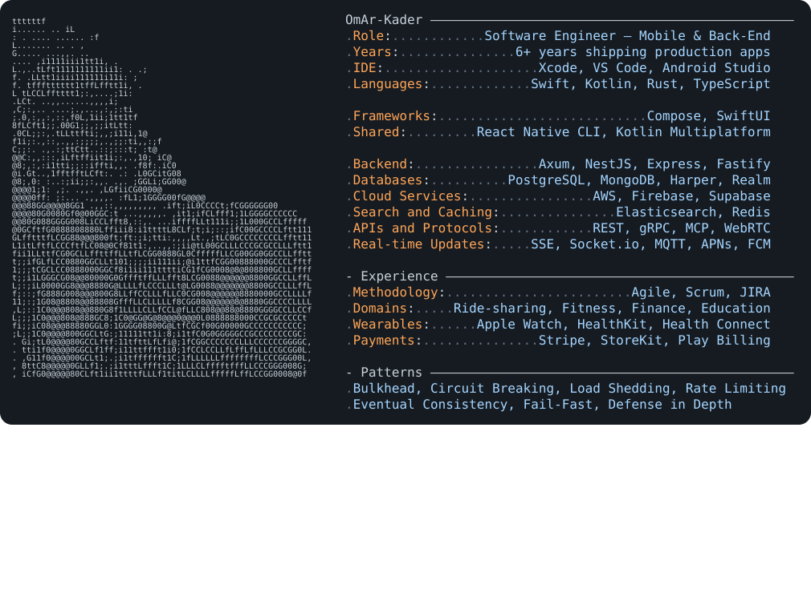

<h1 align="center">Hi, I'm Omar Kader 👋</h1>
<h3 align="center">Software Engineer — Mobile & Back-End</h3>

 

 

 

 
 
 
 
 
 
   
 
 
 
 
  
 
 
 
 
 
 
 
 
 
 
 
 
 
 
 
 
 
 
 
 
 
 
 
 
 
  
  

 

## 📊 My GitHub stats

  

 

<!--

## 🚀 Skills and Tools

### Mobile Development
- **Android:** Kotlin, Java, Jetpack Compose, Android Studio.
- **iOS:** Swift, SwiftUI, Xcode.
- **Cross-Platform:** Kotlin Multiplatform, Compose Multiplatform, React Native, Flutter.

### Backend and Cloud
- **Backend:** Node.js, Express, Fastify, NestJS.
- **Admin Dashboards:** React, Vite.
- **Databases & Job Scheduling:** PostgreSQL, MongoDB, Mongoose, Realm, Agenda.js.
- **Cloud:** AWS (Lambda, API Gateway, DynamoDB, S3, Cognito), Firebase, Supabase.
- **APIs & Communication:** REST, gRPC, WebSockets, Socket.IO, MQTT, WebRTC.

### App Features
Authentication, push notifications, real-time updates, offline support, data synchronization, responsive UI, animations, map tracking, real-time chat, e-commerce, e-learning, Web3 Ethereum, and data visualization with Chart Swift API.
- **Integrations:** Google Maps, Drive, Sheets, Translation, Docs, Slides, and other Google APIs.
- **Platform Expansion:** Porting iOS apps to iPadOS and visionOS.

### Testing, Design & Workflow
- **Testing:** JUnit, XCTest, Flutter Test.
- **UI/UX & Graphics:** Figma, Adobe XD, Illustrator, Photoshop.
- **Version Control & Management:** Git, Agile, Jira.
- **Open Source:** Active GitHub contributor.

### Freelance
Available on **Upwork, Contra, and Fiverr**. Effective in both independent and team environments.

 

 
 
 

## 🏆 GitHub Trophies

 https://simpleicons.org/
 https://www.vectorlogo.zone/
 https://github.com/marwin1991/profile-technology-icons/blob/main/README.md
 
 

 

## 🤩 Support Me

 

-->
